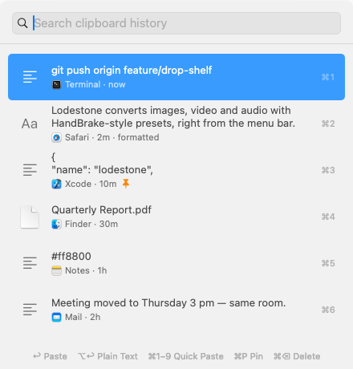
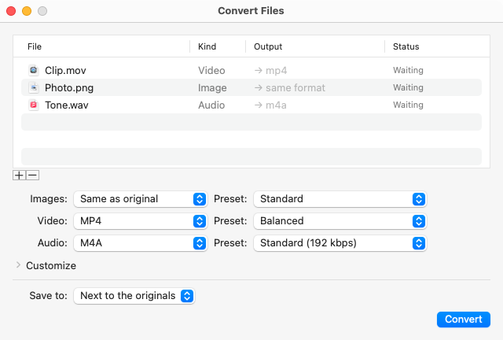
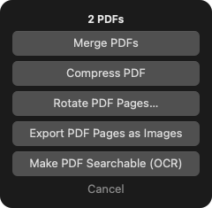
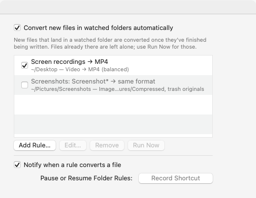
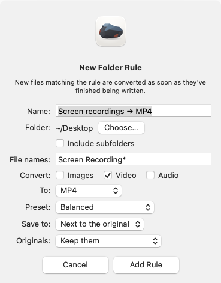

<p align="center">
  
</p>

<h1 align="center">Lodestone</h1>

<p align="center">
  <b>The quick utilities macOS is missing, in one menu bar app.</b><br>
  Window snapping, a media converter, PDF tools, clipboard history, screen text and a color picker,<br>
  all scriptable from the command line.
</p>

<p align="center">
  
  
  
  
</p>

<p align="center">
  
  &nbsp;
  
</p>

## Why Lodestone

- **One small app instead of five.** Window snapping, a HandBrake-style converter, PDF tools, a clipboard manager,
  OCR and a color picker share one menu bar icon, one Settings window and one set of shortcuts.
- **Zero idle cost.** Nothing runs while you aren't using a feature: no event taps, no background work.
  Monitors and timers exist only while their feature is on and needed; the busiest one, clipboard history,
  compares a single number twice a second.
- **Private by design.** Everything runs on your Mac. Lodestone makes no network connections. Its activity log
  records what happened (files, sizes, errors), never clipboard text, screen text or file contents.
- **Scriptable.** Every feature is also a `lodestone` command with `--json` output, for shell scripts,
  Shortcuts and AI agents.
- **Native.** Swift and AppKit, no Electron and no SwiftUI. It feels like part of macOS.

## Features

### Window snapping
Halves, quarters, thirds, two-thirds and sixths from the keyboard, or by dragging a window to a screen edge.
Press a shortcut again and the window moves to the same position on the next display. Restore puts it back.
[Details below](#window-snapping-in-detail).

### Converter
Images, video and audio with HandBrake-style presets: Instant (no re-encode), High quality, Balanced, Small
file, Share. Resize, compress and strip metadata and location from photos. WebP, AVIF, HEVC, ProRes, WebM, FLAC
at 24-bit/96 kHz, and more. Save your own presets. → [docs/converter.md](docs/converter.md)

### Drop shelf


Start dragging files anywhere and **shake the pointer**: a drop target appears next to it. Drop the files and it
lists everything Lodestone can do with them: convert, compress, merge PDFs, remove a background. It works with
the menu bar hidden. You can also drop on the menu bar icon or use Finder's right-click menu.

### Folder rules
Convert new files automatically. For example, new screen recordings on the Desktop become MP4s, or screenshots
get compressed. Lodestone waits until a file has finished being written and never converts its own output.
→ [docs/rules.md](docs/rules.md)

### PDF tools and background removal
Merge, compress (with Ghostscript when installed; text stays selectable), images to PDF, extract and split pages,
rotate, export pages as images, and OCR to make scans searchable. Cut the subject out of a photo into a
transparent PNG with Vision. → [docs/pdf-and-image-tools.md](docs/pdf-and-image-tools.md)

### Clipboard history and paste as plain text
A searchable history of text, rich text, images and files, with pinned items. It skips passwords: items that
password managers mark as concealed, and anything copied while 1Password, Bitwarden or Passwords is in front.
Paste as plain text strips formatting, then puts the formatted copy back. → [docs/clipboard.md](docs/clipboard.md)

### Copy text from the screen
Drag over any region to copy its text, keeping line breaks, or the contents of a QR code or barcode.
→ [docs/screen-and-text.md](docs/screen-and-text.md)

### Color picker
Click any pixel and get it as hex, `rgb()`, `hsl()`, SwiftUI, `NSColor` or `UIColor`. The last ten colors stay in
the menu, ready to copy in another format.

### Clipboard transforms
Turn the clipboard's text into something else in place: pretty-print or minify JSON, Base64, URL and HTML
encoding, decode a JWT, convert Unix timestamps, generate UUIDs, change case, sort and dedupe lines, hash with
MD5/SHA-1/SHA-256. Every transform can have its own shortcut.

<p align="center">
  
  &nbsp;
  
</p>

## Default shortcuts

| Action | Keys |
| --- | --- |
| Clipboard history | <kbd>⌃</kbd><kbd>⌥</kbd><kbd>V</kbd> |
| Paste as plain text | <kbd>⌃</kbd><kbd>⌥</kbd><kbd>⇧</kbd><kbd>V</kbd> |
| Copy text from screen | <kbd>⌃</kbd><kbd>⌥</kbd><kbd>⇧</kbd><kbd>T</kbd> |
| Pick a color | <kbd>⌃</kbd><kbd>⌥</kbd><kbd>⇧</kbd><kbd>C</kbd> |
| Drop shelf | drag files, then shake |

<details>
<summary><b>Window snapping shortcuts</b> (Magnet-compatible, plus sixths)</summary>

| Action | Keys |
| --- | --- |
| Left / Right / Top / Bottom half | <kbd>⌃</kbd><kbd>⌥</kbd> + <kbd>←</kbd> <kbd>→</kbd> <kbd>↑</kbd> <kbd>↓</kbd> |
| Top left / Top right / Bottom left / Bottom right | <kbd>⌃</kbd><kbd>⌥</kbd> + <kbd>U</kbd> <kbd>I</kbd> <kbd>J</kbd> <kbd>K</kbd> |
| Left / Center / Right third | <kbd>⌃</kbd><kbd>⌥</kbd> + <kbd>D</kbd> <kbd>F</kbd> <kbd>G</kbd> |
| Left / Center / Right two thirds | <kbd>⌃</kbd><kbd>⌥</kbd> + <kbd>E</kbd> <kbd>R</kbd> <kbd>T</kbd> |
| 1/6 … 6/6 (six columns, left to right) | <kbd>⌃</kbd><kbd>⌥</kbd> + <kbd>1</kbd> … <kbd>6</kbd> |
| Maximize | <kbd>⌃</kbd><kbd>⌥</kbd><kbd>↩</kbd> |
| Center | <kbd>⌃</kbd><kbd>⌥</kbd><kbd>C</kbd> |
| Restore | <kbd>⌃</kbd><kbd>⌥</kbd><kbd>⌫</kbd> |
| Next / Previous display | <kbd>⌃</kbd><kbd>⌥</kbd><kbd>⌘</kbd> + <kbd>→</kbd> <kbd>←</kbd> |

</details>

<details>
<summary><b>Clipboard history panel keys</b></summary>

| Action | Keys |
| --- | --- |
| Search | just type |
| Paste the selected item | <kbd>↩</kbd> |
| Paste it as plain text | <kbd>⌥</kbd><kbd>↩</kbd> |
| Quick-paste item 1–9 | <kbd>⌘</kbd><kbd>1</kbd> … <kbd>⌘</kbd><kbd>9</kbd> |
| Pin / unpin | <kbd>⌘</kbd><kbd>P</kbd> |
| Delete | <kbd>⌘</kbd><kbd>⌫</kbd> |
| Close | <kbd>esc</kbd> |

</details>

Every command can be given a shortcut in Settings, including each PDF action and each clipboard transform. Click a
shortcut and press the new combination. A shortcut shown in red is already taken by another app.

## Install

Requirements: macOS 14 Sonoma or later, and Xcode 16 or a Swift 6 toolchain.

```sh
git clone https://github.com/egeaksun/lodestone.git
cd lodestone
make install   # builds, copies to /Applications, links ~/.local/bin/lodestone, launches
```

Then, in **System Settings → Privacy & Security**, turn on Lodestone under:

- **Accessibility** for window snapping, and for pasting from clipboard history and Paste as Plain Text.
- **Screen & System Audio Recording** for Copy Text from Screen. Quit and reopen Lodestone afterwards.

If you use Magnet or Rectangle, quit it first: they register the same snapping shortcuts.

**Optional tools** add formats and stronger PDF compression. Lodestone works without them and tells you which
one to install when it needs it:

```sh
brew install ffmpeg webp libavif ghostscript
```

> [!NOTE]
> The build is signed ad hoc, so macOS treats every rebuild as a new app and forgets its permissions. Turn
> Lodestone on again after each `make install`, or sign with a stable certificate:
> `make install SIGN_ID="Apple Development: …"`.

## Command line

`lodestone` drives every feature. Conversions, PDF work, OCR of files and text transforms run inside the CLI
process, so they work without the app. Windows, clipboard history, screen capture, the color picker and folder
rules go through the running app (it starts if needed). Every command takes `--json`.

```sh
lodestone convert clip.mov --to mp4 --preset share
lodestone convert song.wav --to flac --sample-rate 96000 --bit-depth 24
lodestone convert clip.mov --dry-run          # print the exact ffmpeg command
lodestone rules add ~/Desktop --kinds video --to mp4 --match 'Screen Recording*'
lodestone pdf merge a.pdf b.pdf -o both.pdf
lodestone pdf compress big.pdf --level strong
lodestone image remove-background photo.jpg --crop
lodestone clipboard history --search invoice
lodestone ocr screenshot.png
lodestone text json-pretty < response.json
lodestone color convert '#ff8800' --to swiftui
lodestone window snap leftHalf --app Safari
lodestone shortcuts set pdf.merge ctrl+opt+m
lodestone logs --since 2h --category converter
```

Discover the rest with `lodestone --help`, `lodestone commands` (everything a shortcut can run) and
`lodestone methods` (every method the app exposes, with its parameters).

## Window snapping in detail

**Moving across displays.** Press a shortcut on a window that's already in that position and it moves to the
same position on the next display. Left-side positions move left, right-side and centered ones move right, and
it wraps around. Displays are ordered by where they physically sit. A repeat is recognized from the last
action and from the window's frame, so it also works for windows snapped by dragging.

**Drag to snap.** Drag a window by its title bar to a screen edge. Corners give quarters, the top edge
maximizes, the side edges give halves (top and bottom halves near their ends), and the bottom edge gives thirds
and two-thirds. A snapped window that is dragged away goes back to its previous size. If macOS's own tiling is
on, turn it off so the two don't compete: System Settings → Desktop & Dock → "Drag windows to screen edges to
tile".

**Why it doesn't lag.** Snapping apps usually make window dragging choppy for one of two reasons: an active
event tap, which makes the window server wait on the app for every mouse event, or Accessibility calls on every
dragged event. Lodestone avoids both:

- Mouse input comes from passive `NSEvent` global monitors, which receive copies of events after the fact.
- The drag monitor exists only while the button is down; each dragged event is a point-in-rectangle test.
- A drag gesture makes about three Accessibility calls in total, on a background queue with a timeout.
- Shortcuts use Carbon `RegisterEventHotKey`, so there's no keyboard event tap.
- The preview overlay is one reused, layer-backed window, touched only when the target zone changes.

## Project layout

| Path | What's there |
| --- | --- |
| `Sources/LodestoneCore` | Pure logic: snap geometry, presets and ffmpeg arguments, folder rule matching, text transforms, colors, page ranges, clipboard history. Unit tested. |
| `Sources/LodestoneKit` | Engines shared by the app and the CLI: activity log, IPC, external tools, converter, PDF, background removal, OCR, clipboard store, folder watcher. |
| `Sources/Lodestone` | The app. `Framework/` is the plumbing; `Features/<Name>/` has one folder per feature. |
| `Sources/LodestoneCLI` | The `lodestone` command, one file per command group. |
| `docs/` | User documentation for each feature. |

```sh
swift build
swift test   # or: make test
```

## Contributing

Issues and pull requests are welcome. [AGENTS.md](AGENTS.md) explains the architecture and how to add a feature,
and lists the rules every feature follows: zero idle cost, log outcomes not contents, and full CLI parity.
[ROADMAP.md](ROADMAP.md) lists what's planned next.

The app icon is drawn in code: `Assets/*.svg` are generated by `scripts/generate-icon-svgs.py`, and `make icons`
renders them into `Resources/`.

## License

[MIT](LICENSE)
